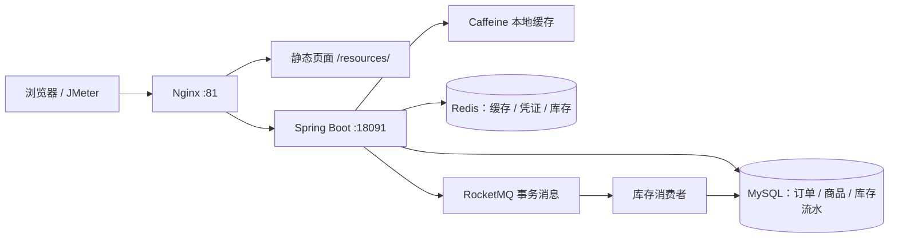
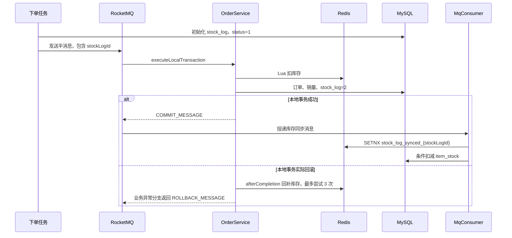

# Miaosha · 高并发秒杀系统

基于 Spring Boot、MyBatis、Redis、Caffeine 和 RocketMQ 的电商秒杀学习项目，包含用户注册登录、商品浏览、活动库存预热、秒杀令牌发放与下单。项目围绕热点读、库存竞争和突发下单流量，逐步实现多级缓存、Lua 原子扣库存、有界线程池以及事务消息库存同步，并保留多组对照实验开关。

本文依据当前 Java 源码、Mapper XML、SQL 与部署脚本整理。部分历史文档中的参数与当前实现不同，以下明确区分源码行为、部署前提和历史压测记录。

## 导航

- [功能与技术栈](#功能与技术栈)
- [架构与核心链路](#架构与核心链路)
- [快速开始](#快速开始)
- [接口与调用示例](#接口与调用示例)
- [配置开关](#配置开关)
- [数据模型与 Redis Key](#数据模型与-redis-key)
- [压测与一致性检查](#压测与一致性检查)
- [当前实现边界](#当前实现边界)
- [代码导航与文档](#代码导航与文档)

## 功能与技术栈

| 模块 | 当前能力 |
| --- | --- |
| 用户 | OTP 注册、手机号密码登录、Redis 登录凭证；OTP 打印到应用日志 |
| 商品 | 创建、列表、详情；详情支持无缓存、Redis、多级缓存三种模式 |
| 活动 | 查询活动时间状态；发布时预热 Redis 库存并初始化令牌大闸 |
| 下单准入 | 图形验证码、活动令牌、大闸、Guava 限流、售罄标记、有界线程池 |
| 库存 | MySQL 条件更新、Redis INCR、Redis Lua 三种扣减实现 |
| 消息 | RocketMQ 事务消息、本地订单事务、库存流水回查、数据库库存异步同步 |
| 页面与部署 | jQuery 静态页面、Nginx 代理、Docker 分服务脚本、双实例部署配置 |

| 技术 | 仓库版本或用途 |
| --- | --- |
| Java | JDK 8；实际 Maven Compiler 配置为 source/target 1.8 |
| Spring Boot | 2.0.5.RELEASE |
| MyBatis / Druid | 1.3.1 / 1.1.3 |
| MySQL | Docker 使用 5.7；JDBC 驱动 5.1.41 |
| Redis | 脚本使用 5.0-alpine；Spring Data Redis 访问 |
| RocketMQ | Java 客户端 4.3.0；启动脚本使用 Broker / NameServer 4.9.4 |
| Caffeine / Guava | 2.8.0 / 18.0，分别用于本地缓存与 RateLimiter |
| 其他 | Spring Session、Jackson、自定义 Joda-Time 序列化、Hibernate Validator |

## 架构与核心链路



应用采用 Controller → Service → MyBatis Mapper 分层，模型分为页面对象 `VO`、业务对象 `Model` 与数据库对象 `DO`。下单仍会同步写入 MySQL 订单、销量和库存流水；消息队列异步处理的是数据库库存同步。

### 商品详情：Caffeine → Redis → MySQL

`GET /item/get?id=6` 在 `multi-level` 模式下先查本实例 Caffeine，再查 Redis，最后回源 MySQL。回源结果写入 Redis，并回填 Caffeine；Redis 命中也会回填 Caffeine。

- Caffeine：初始容量 10、最多 100 个 Key、写入后 300 秒过期。
- 商品详情 Redis 缓存：`item_{id}`，30 分钟过期。
- 下单校验另用 `item_validate_{id}`，10 分钟过期；它与商品详情缓存是不同入口。
- 缓存中的库存和活动状态是快照，页面显示值不等于实时可售库存。

实现见 [ItemController](src/main/java/com/imooc/miaoshaproject/controller/ItemController.java) 与 [CacheServiceImpl](src/main/java/com/imooc/miaoshaproject/service/impl/CacheServiceImpl.java)。

### 秒杀准入与下单

```text
发布活动：GET /item/publishpromo?id={promoId}
  └─ MySQL 库存写入 Redis，清除售罄标记，大闸初始化为库存 × 5

用户登录，取得登录 token
  ├─ GET /order/generateverifycode?token=...（启用验证码时）
  ├─ POST /order/generatetoken?token=...
  │    └─ 登录 → 可选验证码校验 → 售罄检查 → 活动时间与商品/用户检查
  │       → 大闸计数减 1 → 发放用户维度 promoToken
  └─ POST /order/createorder?token=...
       └─ RateLimiter → 登录 → 可选活动令牌校验 → 可选售罄检查
          → 线程池提交并等待结果 → 初始化 stock_log → RocketMQ 事务消息
```

当前 `RateLimiter.create(5)` 固定在代码中，表示**每实例每秒 5 个许可**。队列开启时使用 20 个工作线程、容量 100 的 `LinkedBlockingQueue` 和 `AbortPolicy`；拒绝时返回业务错误 `30003`。HTTP 线程调用 `Future.get()` 等待，因此接口会等待下单处理结果，成功响应的 `data` 为 `null`。

登录 token 与秒杀 `promoToken` 是两类凭证：前者保存在 Redis 中，有效期 1 小时；后者按活动、用户、商品组合保存，有效期 30 分钟。当前秒杀令牌可重复使用，重复申请会覆盖该用户原来的令牌并再次消耗大闸计数。

### Lua 库存扣减

[ItemServiceImpl](src/main/java/com/imooc/miaoshaproject/service/impl/ItemServiceImpl.java) 使用 `DefaultRedisScript<Long>` 执行如下核心逻辑：

```lua
local stock = redis.call('GET', KEYS[1])
if not stock then return -1 end
stock = tonumber(stock)
local amount = tonumber(ARGV[1])
if stock < amount then return -2 end
local newStock = stock - amount
redis.call('SET', KEYS[1], newStock)
if newStock == 0 then redis.call('SET', KEYS[2], 'true') end
return newStock
```

脚本在一个原子操作中完成判库存、扣库存和归零售罄标记。返回 `-1` 表示未预热，`-2` 表示库存不足，非负值表示扣减后的剩余库存。库存不足时不会修改库存，避免 INCR 方案先扣成负数再回补的窗口。该原子性覆盖 Redis 脚本内部操作，跨 Redis、MySQL、MQ 的恢复仍依赖下述流程。

### 事务消息与库存流水



Broker 回查 `stock_log`：`2` 返回 COMMIT，`1` 或记录不存在返回 UNKNOWN，其他状态返回 ROLLBACK。生产者捕获 `BusinessException` 时将流水更新为 `3`。消费者使用 `stockLogId` 构造 Redis 去重 Key，设置 1 小时过期后执行数据库库存更新。

这些机制提供最终一致性的基础；消费失败恢复、异常回滚语义等限制见[当前实现边界](#当前实现边界)。源码中尚无定时对账任务。

## 快速开始

### 1. 环境与首次克隆前提

准备 JDK 8、Maven、MySQL 5.7、Redis、RocketMQ NameServer/Broker。使用容器脚本时还需要 Docker 和 Bash，Windows 可使用 WSL 或其他能够运行脚本的 Bash 环境。

```bash
git clone https://github.com/xxneverstop/miaosha.git
cd miaosha
java -version
mvn -version
```

**当前仓库有一项必须处理的配置缺口：** `.gitignore` 的 `application.yml` 与 `config/` 规则会匹配任意层级。本地的 `src/main/resources/application.yml`、`config/RedisConfig.java` 和 `config/WebServerConfiguration.java` 未纳入版本控制，首次克隆不会得到这些文件。运行前需创建下面的配置，并恢复 Redis 配置类。Tomcat 的 keep-alive 定制类可另行恢复，不是核心业务依赖。

<details>
<summary>首次克隆：RedisTemplate 配置示例</summary>

创建 `src/main/java/com/imooc/miaoshaproject/config/RedisConfig.java`。它配置字符串 Key、Jackson 对象 Value、Joda-Time 转换和 Redis Session，供库存 Lua、对象缓存与 OTP 注册使用。示例沿用本项目本地配置的序列化方式。

```java
package com.imooc.miaoshaproject.config;

import com.fasterxml.jackson.databind.ObjectMapper;
import com.fasterxml.jackson.databind.module.SimpleModule;
import com.imooc.miaoshaproject.serializer.JodaDateTimeJsonDeserializer;
import com.imooc.miaoshaproject.serializer.JodaDateTimeJsonSerializer;
import org.joda.time.DateTime;
import org.springframework.context.annotation.Bean;
import org.springframework.context.annotation.Configuration;
import org.springframework.data.redis.connection.RedisConnectionFactory;
import org.springframework.data.redis.core.RedisTemplate;
import org.springframework.data.redis.serializer.Jackson2JsonRedisSerializer;
import org.springframework.data.redis.serializer.StringRedisSerializer;
import org.springframework.session.data.redis.config.annotation.web.http.EnableRedisHttpSession;

@Configuration
@EnableRedisHttpSession(maxInactiveIntervalInSeconds = 3600)
public class RedisConfig {
    @Bean
    public RedisTemplate<String, Object> redisTemplate(RedisConnectionFactory factory) {
        RedisTemplate<String, Object> template = new RedisTemplate<>();
        template.setConnectionFactory(factory);
        template.setKeySerializer(new StringRedisSerializer());
        ObjectMapper mapper = new ObjectMapper();
        SimpleModule module = new SimpleModule();
        module.addSerializer(DateTime.class, new JodaDateTimeJsonSerializer());
        module.addDeserializer(DateTime.class, new JodaDateTimeJsonDeserializer());
        mapper.registerModule(module);
        mapper.enableDefaultTyping(ObjectMapper.DefaultTyping.NON_FINAL);
        Jackson2JsonRedisSerializer<Object> serializer =
                new Jackson2JsonRedisSerializer<>(Object.class);
        serializer.setObjectMapper(mapper);
        template.setValueSerializer(serializer);
        return template;
    }
}
```

默认 JDK 序列化不能直接替代这套配置：Lua 的 `GET` / `tonumber` 与对象缓存反序列化都依赖兼容的数据格式。切换序列化方式后应使用独立测试数据库或重新初始化对应缓存。

</details>

### 2. 初始化数据库与应用配置

在新建的测试数据库中导入 [sql/miaosha.sql](sql/miaosha.sql)。该文件包含 `DROP TABLE` 和演示数据，只应用于允许重建的测试库。

```bash
mysql -h 127.0.0.1 -P 13306 -u root -p \
  -e "CREATE DATABASE IF NOT EXISTS miaosha CHARACTER SET utf8mb4;"
mysql -h 127.0.0.1 -P 13306 -u root -p miaosha < sql/miaosha.sql
```

创建 `src/main/resources/application.yml`，按实际环境调整连接地址。以下端口对应分服务 Docker 脚本映射到宿主机的端口，直接安装的服务应改成其实际端口。

```yaml
server:
  port: 18091
mybatis:
  mapper-locations: classpath:mapping/*.xml
spring:
  datasource:
    name: miaosha
    type: com.alibaba.druid.pool.DruidDataSource
    driver-class-name: com.mysql.jdbc.Driver
    url: ${SPRING_DATASOURCE_URL:jdbc:mysql://127.0.0.1:13306/miaosha?useUnicode=true&characterEncoding=UTF-8&useSSL=false}
    username: ${SPRING_DATASOURCE_USERNAME:root}
    password: ${SPRING_DATASOURCE_PASSWORD}
  redis:
    host: ${SPRING_REDIS_HOST:127.0.0.1}
    port: ${SPRING_REDIS_PORT:16379}
    password: ${SPRING_REDIS_PASSWORD}
    database: 10
mq:
  nameserver:
    addr: ${MQ_NAMESERVER_ADDR:127.0.0.1:19876}
  topicname: stock_topic
miaosha:
  stock-mode: lua
  cache-mode: multi-level
  sold-out-flag: true
  second-kill-gate: true
  queue-discharge: true
  mq-async-sync: true
  verify-code: false
```

通过环境变量设置自己的数据库、Redis 密码。Linux / Bash 使用 `export SPRING_DATASOURCE_PASSWORD='你的数据库密码'` 和 `export SPRING_REDIS_PASSWORD='你的Redis密码'`；PowerShell 使用 `$env:SPRING_DATASOURCE_PASSWORD='你的数据库密码'` 和 `$env:SPRING_REDIS_PASSWORD='你的Redis密码'`。没有 Redis 密码时将对应变量设为空字符串。

```bash
mvn clean package -DskipTests
# 产物：target/miaosha-1.0-SNAPSHOT.jar
java -jar target/miaosha-1.0-SNAPSHOT.jar
# 开发时也可使用：mvn spring-boot:run
```

应用监听 `18091`。先用 `GET http://localhost:18091/item/list` 检查响应，再按[调用示例](#接口与调用示例)登录、发布活动和下单。Producer 与 Consumer 会随应用初始化，关闭异步同步开关也不会移除 RocketMQ 的启动依赖。

### 3. 使用分服务 Docker 脚本

以下命令在仓库根目录的 Bash 中运行。先检查各脚本顶部的端口、内存、密码参数；MySQL、Redis 与应用脚本中的凭证必须一致。

```bash
bash scripts/start-mysql.sh
bash scripts/start-redis.sh
# 替换为应用容器和开发机都能访问的宿主机地址，写入 Broker 对外通告地址
BROKER_HOST_IP=192.168.1.100
bash scripts/start-rocketmq.sh "$BROKER_HOST_IP"

mvn clean package -DskipTests
cp target/miaosha-1.0-SNAPSHOT.jar miaosha.jar
# Dockerfile 还会加载此文件；如果无需覆盖配置，也应先创建一个空文件
touch application.yml
bash scripts/start-app.sh
bash scripts/start-nginx.sh
bash scripts/status.sh
```

MySQL 脚本会在数据卷首次初始化时导入 `sql/` 中的 SQL。已有数据卷不会重新导入。Dockerfile 的构建输入是根目录 `miaosha.jar`，每次修改 Java 代码后都需要重新打包并复制。

| 服务 | 宿主机端口 | 容器端口 |
| --- | --- | --- |
| Nginx | 81 | 80 |
| 应用实例 1 | 18091 | 18091 |
| 应用实例 2（可选） | 18092 | 18091 |
| MySQL | 13306 | 3306 |
| Redis | 16379 | 6379 |
| RocketMQ NameServer | 19876 | 9876 |
| RocketMQ Broker | 10911 | 10911 |

浏览器入口为 `http://localhost:81/resources/login.html`，商品列表为 `/resources/listitem.html`。Nginx 只在 `/resources/` 下提供静态页面，其他路径转发后端。`start-nginx.sh` 会将 `html/gethost.js` 改为 `window.location.host`，使页面 API 请求走相同代理地址。

可选第二实例由 `bash scripts/start-app2.sh` 启动。使用 `nginx/nginx-scale.conf` 前，需要把其中实例 2 的上游端口从 `18092` 改成 **18091**：Nginx 在 Docker 网络里使用容器端口，18092 是宿主机映射端口；再调整 `start-nginx.sh` 的 `CONF_FILE` 并重新启动 Nginx。

查看应用日志使用 `docker logs -f miaosha-app-1`。`bash scripts/stop-all.sh` 会停止并删除脚本创建的容器，保留 MySQL 命名数据卷；Redis 和 RocketMQ 脚本没有挂载持久化数据卷，重建容器会丢失其容器内数据。

<details>
<summary>现有 Docker Compose 的适用范围</summary>

[docker-compose.yml](docker-compose.yml) 当前只声明 `app` 和 `mysql`，没有编排 Redis、RocketMQ 或 Nginx。不能把 `docker compose up -d` 当作完整系统的一键启动命令。

使用前需自行准备 Redis / MQ、根目录 `miaosha.jar` 与 `application.yml`，并创建 `.env`，提供 `JAVA_OPTS`、`MYSQL_HOST`、`MYSQL_DATABASE`、`MYSQL_USERNAME`、`MYSQL_PASSWORD`；其中 `MYSQL_HOST=mysql` 表示 Compose 内的数据库服务。应用的 Redis / MQ 地址需通过挂载配置文件设置为可达地址。Compose 与分服务脚本的数据库数据卷不同，也会争用相同容器名和宿主机端口，应选择一种方式运行。

</details>

## 接口与调用示例

POST 业务接口使用 `application/x-www-form-urlencoded`，参数名保留源码拼写 `telphone`。登录 token 通过请求参数 `token` 传递。

| 方法 | 路径 | 主要参数与说明 |
| --- | --- | --- |
| POST | `/user/getotp` | `telphone`；OTP 写入 Session 并打印到日志 |
| POST | `/user/register` | `telphone, otpCode, name, gender, age, password`；需保留获取 OTP 时的 Cookie |
| POST | `/user/login` | `telphone, password`；返回登录 token，密码传明文，由服务端计算摘要 |
| GET¹ | `/user/get` | `id`；用户基本信息 |
| POST | `/item/create` | `title, description, price, stock, imgUrl` |
| GET | `/item/list` | 商品列表 |
| GET | `/item/get` | `id`；商品详情与活动信息 |
| GET | `/item/publishpromo` | `id` 是活动 ID；初始化 Redis 库存与大闸 |
| GET / POST | `/order/generateverifycode` | `token`；返回 JPEG 验证码图片 |
| POST | `/order/generatetoken` | `token, itemId, promoId, verifyCode`；返回秒杀令牌 |
| POST | `/order/createorder` | `token, itemId, amount`；活动下单再传 `promoId, promoToken` |

¹ `/user/get` 的映射未限制 HTTP 方法，此处以 GET 展示。当前没有活动创建 API，演示活动由 SQL 导入；新增活动需自行维护 `promo` 表。

### 跑通一次活动下单

1. 通过 `/user/getotp` 和 `/user/register` 创建测试账号，或使用自己已知密码的账号登录。OTP 只打印在日志，尚未接入短信服务。
2. 确认演示活动 `promo.id=1`、商品 `item.id=6` 存在且正在进行。种子 SQL 的活动时间固定，必要时在测试库更新 `start_date` / `end_date`，并在预热缓存之前完成。
3. 在没有在途订单和库存同步消息时发布活动。发布会用 MySQL 库存覆盖 Redis，不应在交易过程中反复调用。

```bash
# 以下示例使用默认 verify-code=false；把占位凭证替换为接口真实返回值
curl -X POST 'http://localhost:18091/user/login' \
  --data-urlencode 'telphone=你的测试手机号' \
  --data-urlencode 'password=你的测试密码'

curl 'http://localhost:18091/item/publishpromo?id=1'

curl -X POST 'http://localhost:18091/order/generatetoken?token=<登录token>' \
  -d 'itemId=6&promoId=1&verifyCode=42'

curl -X POST 'http://localhost:18091/order/createorder?token=<登录token>' \
  -d 'itemId=6&amount=1&promoId=1&promoToken=<秒杀令牌>'
```

`verifyCode` 在 Spring 参数绑定层仍是必填项，关闭验证码时也应传入。启用验证码后，先获取图片并填写实际字符；当前 `getitem.html` 的下单按钮采用跳过验证码的演示流程，需同时切回页面中保留的验证码交互。活动下单数量范围为 1～99。

### 响应格式

```json
{"status":"success","data":null}
```

```json
{"status":"fail","data":{"errCode":30003,"errMsg":"活动太火爆，请稍后再试"}}
```

业务异常通常仍以 HTTP 200 返回，调用方和压测工具应检查 JSON 的 `status`，并按 `data.errCode` 区分库存不足 `30001`、限流 `30003`、未登录 `20003`、参数错误 `10001` 等。验证码接口直接返回图片，不使用此 JSON 包装。

## 配置开关

下表“本地配置值”依据当前工作目录中未跟踪的 `src/main/resources/application.yml`，首次克隆可使用上面的完整示例。RateLimiter 的 5 QPS 与线程池参数目前没有配置项。

| 配置项 | 本地配置值 | 实际作用 |
| --- | --- | --- |
| `miaosha.stock-mode` | `lua` | `mysql` 条件扣库、`redis` INCR + 失败回补、`lua` 原子判扣 |
| `miaosha.cache-mode` | `multi-level` | `/item/get` 使用 `none`、`redis-only` 或 `multi-level` |
| `miaosha.sold-out-flag` | `true` | 控制下单入口售罄检查；发令牌入口仍会查售罄标记 |
| `miaosha.second-kill-gate` | `true` | 控制下单入口的活动令牌校验；发令牌仍会扣减大闸 |
| `miaosha.queue-discharge` | `true` | 开启线程池排队；关闭后在请求线程中直接执行 |
| `miaosha.mq-async-sync` | `true` | 开启由消费者同步 DB 库存；关闭则在订单事务中同步扣 DB 库存 |
| `miaosha.verify-code` | `false` | 控制发令牌时验证码校验；Java 注入默认值为 `true` |

**库存开关并非任意组合都可用。** 默认 `lua + mq-async-sync=true` 执行一次 Redis 扣减、一次消费者 DB 扣减；`lua + false` 执行 Redis 扣减、订单事务内 DB 扣减。当前 `mysql` 模式本身已经扣过数据库库存，后续同步或异步分支还会再尝试扣一次，不能直接把它当作正确的 MySQL 基线。切换实验模式前需梳理重复扣减和补偿分支。

## 数据模型与 Redis Key

| MySQL 表 | 用途 |
| --- | --- |
| `user_info` / `user_password` | 用户基础信息与密码摘要，手机号有唯一索引 |
| `item` / `item_stock` | 商品、销量与库存；`item_stock.item_id` 有唯一索引 |
| `promo` | 商品活动、起止时间与活动价格 |
| `order_info` | 用户、商品、活动、购买数量与成交金额 |
| `stock_log` | UUID 库存流水；1 初始、2 下单成功、3 失败标记 |
| `sequence_info` | 订单号序列，查询使用 `SELECT ... FOR UPDATE` |

订单号由日期、补齐到 6 位的数据库序列和固定后缀 `00` 拼接。表字段定义见 [初始化 SQL](sql/miaosha.sql)，实际库存更新使用 `WHERE item_id = ? AND stock >= ?` 防止单次 SQL 把数据库库存减为负数。

| Redis Key | 用途 / 当前过期时间 |
| --- | --- |
| `{登录token}` | UserModel，1 小时 |
| `verify_code_{uid}` | 图形验证码，30 分钟 |
| `promo_token_{promoId}_userid_{uid}_itemid_{iid}` | 秒杀令牌，30 分钟 |
| `promo_door_count_{promoId}` | 令牌大闸，发布时库存 × 5，无显式 TTL |
| `promo_item_stock_{iid}` | Redis 可售库存，无显式 TTL |
| `promo_item_stock_invalid_{iid}` | 售罄标记，回补或发布时清除，无显式 TTL |
| `stock_log_synced_{stockLogId}` | 消费去重，1 小时 |
| `item_{iid}` | 商品详情，30 分钟；Caffeine 同名 Key 为 300 秒 |
| `item_validate_{iid}` | 下单商品校验缓存，10 分钟 |
| `user_calidate_{uid}` | 当前源码实际读写的用户校验 Key；TTL 存在拼写错误，见下文 |

## 压测与一致性检查

仓库保留了[压测方案](docs/秒杀系统压测方案.md)和[历史结果报告](docs/秒杀系统压测结果报告.md)。报告记录了 2 核 2 GB、3 Mbps 公网、500 线程场景下下单吞吐从 142 到 1,200、P99 从 9,500 ms 到 1,650 ms，以及商品查询中 MySQL 读 QPS 约 90 → 2、Redis QPS 约 140 → 45。

这些是历史文档记录，仓库没有配套 `.jmx` / `.jtl` 原始测试文件；当前代码固定 5 QPS 限流，部分缓存参数和库存模式也与报告前提不同，因此上述数字不代表当前默认配置可复现的业务成功吞吐。本次 README 整理未重新执行并发压测。

复测建议按以下顺序：

1. 在独立测试库记录初始库存、销量、订单数量，确认无在途消息；发布一次活动预热库存。
2. 登录并获取有效秒杀令牌，用 JSON 断言分别统计业务成功、库存不足、限流和系统失败，不能只看 HTTP 200 或总 Throughput。
3. 先以 500 线程、Ramp-Up 10 秒、循环 1 次验证正确性，再按实验目的调整持续时间。需要更高成功吞吐时应先明确调整源码中的限流值，记录实际开关和部署参数。
4. 等待 MQ 消费完成后，比较库存、订单购买数量和销量变化；种子库有历史订单，必须比较本轮增量。用购买数量 `SUM(amount)` 计数，订单数仅在每单数量为 1 时等价。

```sql
-- 测试前后分别记录，计算本轮增量
SELECT stock FROM item_stock WHERE item_id = 6;
SELECT sales FROM item WHERE id = 6;
SELECT COUNT(*) AS order_count, COALESCE(SUM(amount), 0) AS ordered_amount
FROM order_info WHERE item_id = 6 AND promo_id = 1;
SELECT status, COUNT(*) FROM stock_log WHERE item_id = 6 GROUP BY status;
```

用 `redis-cli` 连接正确端口、密码及数据库（本文示例是 DB 10）读取 `GET promo_item_stock_6`。在本轮只有该活动交易、库存同步全部成功的前提下，应满足：

```text
Redis 初始库存 - Redis 剩余库存
  = MySQL 初始库存 - MySQL 剩余库存
  = 本轮成功订单购买数量之和
  = 本轮商品销量增量
```

## 当前实现边界

以下内容来自源码核对，便于理解故障恢复范围和后续改进方向：

| 项目 | 当前行为与限制 |
| --- | --- |
| 消费幂等 | Redis `setIfAbsent` 后才扣 DB；加锁、设置 TTL、扣库不是同一原子事务。拿到锁后宕机或 DB 失败可能导致重投被跳过，锁过期后的重投也可能再次扣库；尚无数据库唯一消费记录 |
| DB 库存同步 | Consumer 未检查 `decreaseStock` 的影响行数；可能在更新 0 行时仍确认消费成功 |
| 事务回滚 | `BusinessException` 继承受检 `Exception`，`createOrder` 的 `@Transactional` 未声明 `rollbackFor`；不能假设所有业务异常都触发回滚。Redis 补偿回调只在事务实际回滚时执行 |
| Redis 补偿 | `increaseStock` 的 INCR 与删除售罄标记分开执行；重试缺少补偿幂等记录，进程崩溃或重试也有恢复窗口。补偿失败只记录日志，尚无自动对账任务 |
| 一人一单与请求幂等 | 尚未实现；秒杀令牌不会在下单后消费，允许同一用户重复下单；大闸限制令牌发放次数，不能限制令牌被使用的总次数 |
| 缓存一致性 | 没有主动失效和跨实例本地缓存广播；库存、销量、活动状态可能在 TTL 内陈旧。用户缓存读写 `user_calidate_`，过期设置却使用 `user_validate_`，实际 Key 未被设置 TTL |
| 订单号事务 | `generateOrderNo` 是私有方法并在同类内部调用，不能把其 `REQUIRES_NEW` 注解视作已生效的独立事务 |
| 登录与管理入口 | 密码使用 MD5 + Base64；发布活动、创建商品等接口尚无管理员鉴权；OTP 仅日志模拟。适合隔离的学习与演示环境 |
| 构建与部署 | JDK 8 代码使用 `sun.misc.BASE64Encoder`；配置类被忽略、双实例代理端口、Compose 服务范围需按上文处理 |

[一人一单方案](docs/一人一单-方案设计.md)和其他文档中的扩展设计应与已实现代码区分阅读。

## 代码导航与文档

```text
src/main/java/com/imooc/miaoshaproject/
├── App.java                 Spring Boot 入口与 Mapper 扫描
├── controller/              用户、商品、下单接口与异常处理
├── service/impl/            缓存、活动、库存、用户与订单逻辑
├── service/model/           业务领域模型
├── mq/                      事务消息生产者与库存消费者
├── dao/                     MyBatis Mapper 接口
├── dataobject/              数据库对象
├── serializer/              Joda-Time JSON 转换
├── validator/               参数校验
└── error/、response/、util/   错误码、响应与验证码工具
src/main/resources/mapping/  MyBatis XML
sql/                        表结构与演示数据
html/                       页面、jQuery 与静态资源
nginx/                      单实例 / 双实例代理配置
scripts/                    分服务启动、状态与停止脚本
docs/                       设计分析、修复记录、压测与面试资料
```

建议从 [OrderController](src/main/java/com/imooc/miaoshaproject/controller/OrderController.java) 进入，沿 [MqProducer](src/main/java/com/imooc/miaoshaproject/mq/MqProducer.java) → [OrderServiceImpl](src/main/java/com/imooc/miaoshaproject/service/impl/OrderServiceImpl.java) → [ItemServiceImpl](src/main/java/com/imooc/miaoshaproject/service/impl/ItemServiceImpl.java) 阅读下单，再看 [MqConsumer](src/main/java/com/imooc/miaoshaproject/mq/MqConsumer.java) 和 [PromoServiceImpl](src/main/java/com/imooc/miaoshaproject/service/impl/PromoServiceImpl.java)。

| 文档 | 阅读内容 |
| --- | --- |
| [Redis Lua 扣库存](docs/Redis-Lua原子库存扣减-方案与问题分析.md) | INCR 方案到 Lua 的演进 |
| [Redis 事务回退](docs/Redis库存事务回退问题分析.md) | 数据库事务与 Redis 补偿 |
| [库存不一致排查](docs/库存不一致问题排查与修复.md) | 消息重投与重复扣库问题 |
| [线程池有界队列](docs/线程池有界队列改造.md) | 队列容量与拒绝策略 |
| [多级缓存讲稿](docs/multi-level-cache-interview.md) | 商品读链路与参数解释 |
| [流量治理改动](docs/第九十章-流量削峰防刷限流代码改动详解.md) | 验证码、限流与大闸实现 |
| [项目总结与问答](docs/秒杀项目-简历与面试问答总结.md) | 项目学习记录与面试复盘 |
