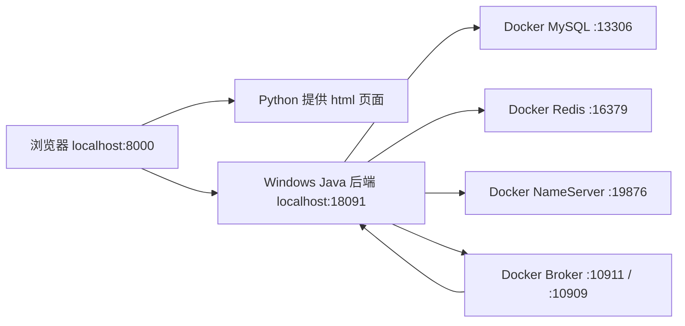

# 本机开发运行指南：Windows 后端 + Docker 依赖

> 更新日期：2026-11-20。
>
> 适用场景：在当前 Windows 电脑上学习、调试和修改本项目。后端使用 JDK 8 在 Windows 本机运行，MySQL、Redis、RocketMQ 使用 Docker Desktop 的 Linux 容器。前端先用 Python 自带的静态文件服务。
>
> 本文依据当前源码、配置和启动脚本编写。本次只读检查了本机工具和 Docker 状态，并编写本文，没有创建容器、修改实际连接配置或执行下单验证。下面的命令需要你按顺序执行。

## 1. 采用什么运行方式，为什么

### 1.1 各部分放在哪里

| 部分 | 运行位置 | 用途 |
| --- | --- | --- |
| Java 后端 | Windows：先用 Maven 跑通，日常用 IDEA | 接口、订单、库存逻辑；方便重启和打断点 |
| MySQL 5.7 | Docker | 商品、订单、库存流水等数据 |
| Redis 5.0 | Docker | 登录凭证、Session、缓存、库存、活动令牌 |
| RocketMQ 4.9.4 NameServer / Broker | 两个 Docker 容器 | 事务消息和数据库库存同步；Java 客户端仍是项目中的 4.3.0 |
| HTML 页面 | Windows：Python 静态文件服务 | 直接复用 `html/`，无需先配置 Nginx |



日常改 Java，只需要在 IDEA 中重启后端；修改 HTML，刷新页面即可。数据库和消息队列可以继续运行。完整容器方案需要额外打包 JAR、构建镜像和重建应用容器，更适合部署演示。项目 [Roadmap](../roadmap/roadmap.md#32-推荐的默认布局) 也采用这一日常开发布局。

### 1.2 Ubuntu 是否必须安装

本文所有操作都在 **Windows PowerShell** 执行，不要求额外安装 Ubuntu。Docker Desktop 可以使用自身的 WSL 2 后端，并从 Windows 终端接受 `docker` 命令，见 [Docker 官方说明](https://docs.docker.com/desktop/features/wsl/)。

`docker-desktop:~#` 是 Docker Desktop 内部环境，不是本方案的工作终端。看到这个提示符时，执行 `exit` 回到 Windows，然后打开 PowerShell。

已有的 `scripts/*.sh` 仍保留，用于具备 Bash 的环境。本文直接使用 PowerShell 调用 Docker，不混用这些脚本，也不运行根目录的 Compose。

### 1.3 与现有 Nginx 方案的关系

本机开发先使用 Python 提供页面，已有前端代码负责向 `localhost:18091` 发请求。控制器已有 CORS 配置，页面 AJAX 也携带凭证。

当前 `nginx/nginx.conf` 代理的是容器 `miaosha-app-1:18091`；`start-nginx.sh` 还会把 `html/gethost.js` 改成 `window.location.host`。本指南的主流程不启动这个 Nginx 脚本。将来做完整容器部署时，再使用 Nginx 同源代理方案。

## 2. 当前电脑的检查结果

以下为 2026-11-20 编写本文时的只读检查结果，后续以实际检查为准。

| 检查项 | 结果 | 本次运行的处理 |
| --- | --- | --- |
| 默认 Java / Maven 使用的 Java | JDK 21 | 在当前终端切到 JDK 8；IDEA 也单独选择 JDK 8 |
| 已安装的 JDK 8 | `D:\software\jdk-8`，版本 1.8.0_202 | 直接复用 |
| Maven | 3.9.12 | 直接复用 |
| Docker Desktop | Engine 已能连接，当前为 Linux 容器环境 | 直接复用 |
| Python | 3.13.14 | 用于启动前端静态文件服务 |
| 本项目容器 | 未发现下文使用的 `miaosha-*` 容器 | 按首次创建步骤执行 |
| 本项目 MySQL 命名卷 | 未发现 `miaosha-mysql-data` | 首次创建时由 Docker 建立 |
| 根目录 `.env` | 文件已存在；本次未读取其中的真实凭据 | 保留，不覆盖；本文在 PowerShell 中明确设置连接变量 |

Docker 中还有其他项目的旧容器和数据，不需要删除、清理或启动它们。

## 3. 开始前：打开正确终端并检查工具

打开 **Windows PowerShell**，进入项目目录：

```powershell
Set-Location D:\workspace\dianshangmiaosha

$env:JAVA_HOME = 'D:\software\jdk-8'
$env:Path = "$env:JAVA_HOME\bin;$env:Path"

java -version
mvn -version
docker version
python --version
```

检查标准：Java 和 Maven 都显示 Java `1.8`；`docker version` 同时显示 Client 和 Server；Python 可执行。Docker 的 Server 尚未出现时，等待 Docker Desktop Engine 就绪后再继续。

查看是否已有本项目容器：

```powershell
docker ps -a --filter name=miaosha --format 'table {{.Names}}\t{{.Status}}\t{{.Ports}}'
docker volume ls --filter name=miaosha
```

如果已经有下文同名容器，先检查它们的配置和数据归属，按第 8 节启动已有容器。`docker run` 是首次创建，`docker start` 是启动已有容器。遇到名称占用时，先查看已有容器，不直接删除。

本文使用以下宿主机端口：

| Windows 本机访问地址 | Docker 容器内部端口 | 用途 |
| --- | --- | --- |
| `127.0.0.1:13306` | MySQL `3306` | 数据库 |
| `127.0.0.1:16379` | Redis `6379` | Redis |
| `127.0.0.1:19876` | NameServer `9876` | 查找 Broker 路由 |
| `127.0.0.1:10911` | Broker `10911` | Broker 主端口 |
| `127.0.0.1:10909` | Broker `10909` | 本项目客户端默认启用的 VIP 发送端口 |
| `localhost:18091` | 后端直接运行在 Windows | HTTP API |
| `localhost:8000` | Python 直接运行在 Windows | 前端页面 |

检查已有监听，确认没有占用：

```powershell
Get-NetTCPConnection -State Listen -ErrorAction SilentlyContinue |
    Where-Object { $_.LocalPort -in @(13306, 16379, 19876, 10911, 10909, 18091, 8000) } |
    Select-Object LocalAddress, LocalPort, OwningProcess
```

## 4. 首次创建 Docker 依赖

本节在**同一个 PowerShell 窗口**中依次执行。每条 Docker 创建命令成功后会返回容器 ID；出现错误时先处理错误，再继续。

### 4.1 设置本机开发密码和工作目录

下面通过交互输入密码，输入内容不会显示在终端或写入命令历史。本文首次创建本机开发环境时，密码使用英文字母、数字、下划线、连字符，并妥善保存。这个字符范围用于兼容 Windows PowerShell 5.1 的原生命令参数传递，避免双引号等字符在传给 Docker 时改变含义。

```powershell
$taskProjectRoot = (Get-Location).Path

$env:MYSQL_PASSWORD = [System.Net.NetworkCredential]::new('', (Read-Host '请输入本机开发 MySQL 密码' -AsSecureString)).Password
$env:REDIS_PASSWORD = [System.Net.NetworkCredential]::new('', (Read-Host '请输入本机开发 Redis 密码' -AsSecureString)).Password

if ($env:MYSQL_PASSWORD -notmatch '^[A-Za-z0-9_-]+$' -or $env:REDIS_PASSWORD -notmatch '^[A-Za-z0-9_-]+$') {
    throw '本文新建开发环境的密码只使用英文字母、数字、下划线、连字符，且不能为空。'
}
```

后续容器和当前终端启动的 Java 会使用同一组密码。已有环境沿用其现用密码和配置，不为套用首次创建步骤而改动密码。容器环境参数可被有本机 Docker 管理权限的人查看；本指南的容器只发布到本机回环地址。

Spring Boot 和 PowerShell 都不会自动加载仓库的 Bash 格式 `.env`。本文通过 `$env:...` 显式传值，不解析或执行该文件。若你之后选择仓库 Bash 脚本，才需要核对它们读取的 `.env`；不要无意中混用历史云端连接。

### 4.2 建立 Docker 网络

首次创建时执行：

```powershell
docker network create miaosha-net
```

若提示网络已经存在，确认是本项目使用的网络后继续复用。

### 4.3 创建 MySQL 并初始化测试库

```powershell
docker run -d `
  --name miaosha-mysql `
  --network miaosha-net `
  --publish 127.0.0.1:13306:3306 `
  --env "MYSQL_ROOT_PASSWORD=$env:MYSQL_PASSWORD" `
  --env 'MYSQL_ROOT_HOST=%' `
  --env MYSQL_DATABASE=miaosha `
  --env TZ=Asia/Shanghai `
  --mount "type=bind,source=$taskProjectRoot\sql,target=/docker-entrypoint-initdb.d,readonly" `
  --mount 'type=volume,source=miaosha-mysql-data,target=/var/lib/mysql' `
  --restart always `
  --memory 256m `
  mysql:5.7 `
  --character-set-server=utf8mb4 `
  --collation-server=utf8mb4_unicode_ci `
  --default-time-zone=+08:00 `
  --sql-mode=NO_ENGINE_SUBSTITUTION
```

查看初始化过程：

```powershell
docker logs -f miaosha-mysql
```

等待初始化 SQL 执行完毕，最终服务监听 `3306` 并显示 `ready for connections`。按 `Ctrl+C` 结束日志查看，不会停止容器。

验证表和种子数据：

```powershell
docker exec -it miaosha-mysql mysql -uroot -p miaosha
```

输入刚才设置的 MySQL 密码，在 MySQL 终端执行：

```sql
SHOW TABLES;
SELECT id, title FROM item;
SELECT item_id, stock FROM item_stock;
SELECT id, item_id, start_date, end_date FROM promo;
exit;
```

应能看到商品 `6`、`7`，以及活动 `1`。`sql/miaosha.sql` **包含 DROP TABLE，只用于可重建的测试库**。自动导入仅在 MySQL 数据目录首次初始化时发生；已有命名卷不会重新导入，修改密码变量也不会自动修改已有库的密码。

### 4.4 创建 Redis

```powershell
docker run -d `
  --name miaosha-redis `
  --network miaosha-net `
  --publish 127.0.0.1:16379:6379 `
  --restart always `
  --memory 64m `
  redis:5.0-alpine `
  redis-server --requirepass "$env:REDIS_PASSWORD" --appendonly yes

docker exec -it miaosha-redis redis-cli --askpass ping
```

输入 Redis 密码，返回 `PONG` 即通过。

应用使用 Redis **DB 10**。手工查应用 Key 时，需要在 `redis-cli` 加 `-n 10`，或连接后执行 `SELECT 10`。

### 4.5 创建 RocketMQ NameServer

```powershell
docker run -d `
  --name miaosha-rocketmq-namesrv `
  --network miaosha-net `
  --publish 127.0.0.1:19876:9876 `
  --env 'JAVA_OPT_EXT=-Xms80m -Xmx80m -Xmn32m' `
  --restart always `
  --memory 160m `
  apache/rocketmq:4.9.4 sh mqnamesrv

docker logs -f miaosha-rocketmq-namesrv
```

等日志出现 NameServer `boot success`，按 `Ctrl+C` 回到 PowerShell，再创建 Broker。

### 4.6 写入本机开发专用 Broker 配置

配置保存在用户目录下，避免 `mvn clean` 删除容器正在挂载的配置文件。这里创建的是本机开发配置，不覆盖仓库的 Java 或 YAML 配置。

```powershell
$taskBrokerConfigDir = Join-Path $env:USERPROFILE '.miaosha\local-dev'
New-Item -ItemType Directory -Force -Path $taskBrokerConfigDir | Out-Null
$taskBrokerConfigPath = Join-Path $taskBrokerConfigDir 'broker.conf'

@'
brokerClusterName = DefaultCluster
brokerName = broker-a
brokerId = 0
deleteWhen = 04
fileReservedTime = 48
brokerRole = ASYNC_MASTER
flushDiskType = ASYNC_FLUSH
listenPort = 10911
brokerIP1 = 127.0.0.1
autoCreateTopicEnable = true
'@ | Set-Content -LiteralPath $taskBrokerConfigPath -Encoding ASCII
```

`brokerIP1` 是 Broker 通告给 Java 客户端的地址。本方案的 Java 只在 Windows 本机运行，因此通告 `127.0.0.1`，客户端通过宿主机映射端口连接。以后把 Java 放进容器、放到其他电脑或部署服务器时，必须重新选择所有客户端都能访问的通告地址；不能直接沿用这里的 loopback。

这里使用 ASCII 写配置，避免 Windows PowerShell 生成的 UTF-8 BOM 影响首个属性名。

### 4.7 创建 Broker，并开放两个客户端端口

```powershell
docker run -d `
  --name miaosha-rocketmq-broker `
  --network miaosha-net `
  --publish 127.0.0.1:10911:10911 `
  --publish 127.0.0.1:10909:10909 `
  --env 'NAMESRV_ADDR=miaosha-rocketmq-namesrv:9876' `
  --env 'JAVA_OPT_EXT=-Xms128m -Xmx128m -Xmn64m -XX:MaxDirectMemorySize=64m' `
  --mount "type=bind,source=$taskBrokerConfigPath,target=/home/rocketmq/rocketmq-4.9.4/conf/broker.conf,readonly" `
  --restart always `
  --memory 384m `
  apache/rocketmq:4.9.4 sh mqbroker `
  -n miaosha-rocketmq-namesrv:9876 `
  -c /home/rocketmq/rocketmq-4.9.4/conf/broker.conf

docker logs -f miaosha-rocketmq-broker
```

等 Broker 日志出现 `boot success`，按 `Ctrl+C` 回到 PowerShell。

**为什么额外开放 10909？** 项目使用 RocketMQ Java 客户端 4.3.0，两个 Producer 都没有关闭默认启用的 VIP 通道。发送时可能将 Broker 主端口减 2，因此 `10911` 对应 `10909`。只测试 NameServer 或 `10911` 连通，不能证明发送路径就绪。现有 Bash 脚本仅映射 `10911`，所以本文没有直接照搬该端口设置。版本依据见第 11 节官方源码链接。

### 4.8 创建并检查 Topic

```powershell
docker exec miaosha-rocketmq-broker sh mqadmin updateTopic `
  -b 127.0.0.1:10911 -t stock_topic -r 4 -w 4

if ($LASTEXITCODE -ne 0) {
    throw '创建 Topic 失败，请先检查 Broker 日志。'
}

docker exec miaosha-rocketmq-broker sh mqadmin topicList `
  -n miaosha-rocketmq-namesrv:9876

docker exec miaosha-rocketmq-broker sh mqadmin topicRoute `
  -n miaosha-rocketmq-namesrv:9876 -t stock_topic
```

确认列表包含 `stock_topic`，路由的 `brokerAddrs` 包含 `127.0.0.1:10911`。

这里 `mqadmin` 在 Broker 容器内部运行，所以 `updateTopic -b 127.0.0.1:10911` 连接的是 Broker 自己。`topicList`、`topicRoute` 则通过 `-n` 查询 NameServer；不要把旧脚本的 `topicList -b` 写法照抄过来。

## 5. 启动 Windows 本机后端

### 5.1 先在当前 PowerShell 用 Maven 跑通

仍在刚才输入过密码的同一个终端中执行：

```powershell
$env:SPRING_DATASOURCE_URL = 'jdbc:mysql://127.0.0.1:13306/miaosha?useUnicode=true&characterEncoding=UTF-8&useSSL=false'
$env:SPRING_DATASOURCE_USERNAME = 'root'
$env:SPRING_DATASOURCE_PASSWORD = $env:MYSQL_PASSWORD

$env:SPRING_REDIS_HOST = '127.0.0.1'
$env:SPRING_REDIS_PORT = '16379'
$env:SPRING_REDIS_PASSWORD = $env:REDIS_PASSWORD

$env:MQ_NAMESERVER_ADDR = '127.0.0.1:19876'
$env:MQ_TOPICNAME = 'stock_topic'

mvn spring-boot:run
```

看到 `Started App`、Tomcat 监听 `18091`，并且进程持续运行后，再测接口。该终端保留用于后端和日志；在另一个 PowerShell 窗口中执行：

```powershell
Invoke-RestMethod 'http://localhost:18091/item/list' | ConvertTo-Json -Depth 8
```

预期 `status` 为 `success`，`data` 包含商品。HTTP 200 不等于业务成功，要检查 JSON 的 `status`。

本机开发不需要先复制 `miaosha.jar`、执行 `package.bat` 或启动 App 容器。`miaosha.mq-async-sync=false` 也不会移除 Producer / Consumer 的初始化依赖，RocketMQ 仍需准备好。

### 5.2 跑通后，把同样配置保存到 IDEA

1. 用 IDEA 打开 `D:\workspace\dianshangmiaosha`，按 Maven 项目导入 `pom.xml`。
2. Project SDK、Maven Runner 的 JRE、后端运行配置的 JRE 均选择 `D:\software\jdk-8`。Java 21 下的编译错误要先通过切换 JDK 8 排查，项目仍使用 `sun.misc.BASE64Encoder`。
3. 找到 `src/main/java/com/imooc/miaoshaproject/App.java` 的 `main` 方法，建立 Application 或 Spring Boot 运行配置；不依赖 IDEA 的 Spring 插件也可用 Application 配置。
4. Main class 填 `com.imooc.miaoshaproject.App`；Working directory 填项目根目录。
5. 在运行配置的 **Environment variables** 中填写以下变量，每行作为一个键值对，密码替换为本机容器现用密码。不要把说明文字和占位符原样保存。

```text
SPRING_DATASOURCE_URL=jdbc:mysql://127.0.0.1:13306/miaosha?useUnicode=true&characterEncoding=UTF-8&useSSL=false
SPRING_DATASOURCE_USERNAME=root
SPRING_DATASOURCE_PASSWORD=<你的本机MySQL密码>
SPRING_REDIS_HOST=127.0.0.1
SPRING_REDIS_PORT=16379
SPRING_REDIS_PASSWORD=<你的本机Redis密码>
MQ_NAMESERVER_ADDR=127.0.0.1:19876
MQ_TOPICNAME=stock_topic
```

6. 如需固定时区，在 VM options 填 `-Duser.timezone=Asia/Shanghai`。
7. 在 Maven 后端终端按 `Ctrl+C` 停止后端，再从 IDEA 点 Run 或 Debug，避免两份后端争用 `18091`。

PowerShell 的 `$env:...` 只传递给该终端及其新启动的子进程，无法改变已经打开的 IDEA 的环境。IDEA 的运行配置需要自己填写；保留为本机私有配置，不将含密码的配置分享或提交。

`.env` 中的 `JAVA_OPTS` 主要供容器入口使用；IDEA 的 JVM 参数填入 VM options。本方案没有依赖自动读取 `.env` 的 IDEA 插件。

## 6. 启动前端页面

新开一个 PowerShell 窗口：

```powershell
Set-Location D:\workspace\dianshangmiaosha
Get-Content .\html\gethost.js
python -m http.server 8000 --bind 127.0.0.1 --directory .\html
```

当前 `html/gethost.js` 应为：

```javascript
var g_host = "localhost:18091";
```

如果你之前执行过 `start-nginx.sh`，文件可能被改成 `window.location.host`。使用本节 Python 页面时，应手动将该文件恢复为上面的一行，使 API 请求指向后端 `18091`。本文编写时文件已是上述值，没有修改它。

浏览器打开：

- [登录页](http://localhost:8000/login.html)
- [获取注册验证码](http://localhost:8000/getotp.html)
- [商品列表](http://localhost:8000/listitem.html)

这个前端入口没有 `/resources/` 前缀；`/resources/` 是现有 Nginx 配置的路径。本节也不用双击 HTML 的 `file://` 方式打开页面。

页面及页面发出的 API 请求统一使用 `localhost`。Docker 数据库连接使用 `127.0.0.1` 没关系；浏览器注册流程应保持同一主机名和同一浏览器，便于携带 Session Cookie。若页面请求仍发往 `8000/user/...`，检查 `gethost.js` 并强制刷新页面。

## 7. 跑通注册、登录和一次下单

### 7.1 注册与登录

1. 打开登录页，点击注册，输入测试手机号并获取验证码。
2. 页面虽然提示发送短信，当前实现只把 OTP 输出到后端控制台：`telphone = ... & otpCode = ...`。从 Maven 或 IDEA 后端日志中读取。
3. 在注册页填写同一手机号、刚才的 OTP、昵称、性别数字（例如 `1`）、年龄和密码。保持同一浏览器流程，不清理 Cookie。
4. 注册成功后登录。登录 token 会写入浏览器 localStorage，并进入商品列表。

使用自己注册的账号，不假定种子 SQL 中账号的明文密码已知。

### 7.2 确认活动，再预热库存

在没有在途订单和库存同步消息的空闲测试环境中，先查 MySQL 的 `promo` 表。种子数据中活动 `1` 对应商品 `6`，时间为 `2026-05-19 00:04:30` 至 `2026-12-31 00:00:00`；按本文编写日期处于活动期。将来日期变化或数据库内容改变时，以实际表中记录为准。

如需调整测试活动时间，先修改测试库中的 `promo` 记录，再预热库存、读取商品；已有商品缓存可能保留旧活动状态。仅修改数据库后反复刷新页面，不一定立即更新缓存。

在另一个 PowerShell 窗口中发布一次演示活动：

```powershell
Invoke-RestMethod 'http://localhost:18091/item/publishpromo?id=1' | ConvertTo-Json -Depth 5
```

这里 `id=1` 是**活动 ID**。该操作将 MySQL 库存写入 Redis，并初始化大闸；交易过程中反复调用会覆盖 Redis 库存，因此首次下单前做一次即可。

### 7.3 下单并确认结果

1. 在商品列表进入商品 `6`。当前页面固定每次购买 `1` 件，先点击一次下单。
2. 保持默认 `stock-mode=lua`、`mq-async-sync=true`、`verify-code=false`。现有页面已按关闭图形验证码的演示流程发送参数。
3. 观察页面结果和后端日志。当前每实例限流固定为 5 QPS，快速重复点击可能返回 `30003`，先验证单次业务流程。
4. 等待 MQ 消费后，再对比本轮 Redis 库存、MySQL 库存、销量和成功订单购买数量的增量。种子数据已经包含历史订单，不用全表订单数充当本轮新增数。

查询 Redis 库存：

```powershell
docker exec -it miaosha-redis redis-cli --askpass -n 10
```

连接后执行：

```text
GET promo_item_stock_6
GET promo_door_count_1
exit
```

查询 MySQL 订单和库存时，使用第 4.3 节的交互登录方式，执行：

```sql
SELECT stock FROM item_stock WHERE item_id = 6;
SELECT sales FROM item WHERE id = 6;
SELECT COUNT(*) AS order_count, COALESCE(SUM(amount), 0) AS ordered_amount
FROM order_info WHERE item_id = 6 AND promo_id = 1;
```

服务成功启动和单次下单成功，只代表相应路径通过。当前消费幂等、异常事务回滚、补偿和重复请求仍有已知边界，见 [根 README](../../README.md#当前实现边界)；本指南没有修复这些业务问题。

## 8. 以后每天怎么运行

### 8.1 启动已有环境

1. 打开 Docker Desktop，等待 Engine 就绪。
2. 在 PowerShell 启动已有容器：

```powershell
docker start miaosha-mysql miaosha-redis miaosha-rocketmq-namesrv
docker start miaosha-rocketmq-broker
docker ps --filter name=miaosha
```

3. 查看 MySQL、NameServer 和 Broker 日志，确认就绪。`docker start` 返回名字仅表示启动请求成功，不表示依赖已经完成初始化。
4. 在 IDEA 中点 Run 或 Debug，使用保存好的 JDK 8 和环境变量配置。
5. 需要浏览器页面时，在另一个终端启动第 6 节的 Python 静态文件服务。

容器若已因 `--restart always` 自动运行，只检查状态即可。后续不必重新创建网络、重复导入 SQL 或重新创建 Topic；不要把第 4 节的 `docker run` 当成每天的启动命令。

若改用新的 PowerShell 终端通过 Maven 启动后端，需要重新设置 JDK 和第 4.1、5.1 节的环境变量。关闭终端后，进程级环境变量不会自动保留。

### 8.2 停止

先在 IDEA 停止后端，或在 Maven 后端终端按 `Ctrl+C`；前端终端也按 `Ctrl+C`。需要停止依赖时执行：

```powershell
docker stop miaosha-rocketmq-broker
docker stop miaosha-rocketmq-namesrv miaosha-redis miaosha-mysql
```

这些命令停止容器并保留其文件系统。下次用 `docker start` 启动。

当前 Redis、MQ 的示例沿用已有脚本，没有额外挂载数据卷：AOF 和消息数据留在容器文件系统中，删除或重建容器可能丢失。MySQL 使用 `miaosha-mysql-data` 命名卷；不要删除卷或重新执行含 DROP TABLE 的初始化 SQL 来解决一般启动问题。需要可靠备份、容器重建恢复时，再单独完善持久化和备份方案。

### 8.3 改完代码以后

| 改动 | 日常开发操作 |
| --- | --- |
| Java 逻辑、Mapper XML、打包资源 | 在 IDEA 重建并重启后端 |
| HTML / JS / CSS | 刷新浏览器；缓存未更新时强制刷新 |
| 后端运行配置的环境变量 | 更新 IDEA 配置，重启后端 |
| 数据库结构 | 在测试库执行对应变更；不重跑全量初始化 SQL |
| Broker 通告地址或 Docker 端口 | 先评估已有数据和容器配置，再安排更新，普通 `docker start` 不会修改创建时的端口映射 |
| 准备服务器部署演示 | 再打包 JAR、构建应用镜像，按服务器地址配置；使用根 README 的部署路径 |

## 9. 常见问题与排查顺序

| 现象 | 先检查什么 |
| --- | --- |
| `docker-desktop:~#` 中找不到 `/mnt/d/...` | `exit`，回 Windows PowerShell。本指南使用 Windows 路径，不需要进入 Docker 内部发行版 |
| WSL 提示 localhost 代理未镜像 | 属于 WSL 联网配置；本文 PowerShell 路径不依赖普通 WSL 发行版。Docker 拉镜像失败时另查 Docker Desktop 代理及网络 |
| `docker version` 只有 Client | Docker Engine 是否启动、是否使用当前 Linux 容器环境；先在自己的 Windows 终端检查 |
| `sun.misc.BASE64Encoder` 找不到 | `mvn -version` 和 IDEA 运行 JRE 是否确实为 JDK 8 |
| `Could not resolve placeholder MYSQL_PASSWORD` 或数据库密码错误 | 环境变量是否填入当前 Java 进程；已有数据库的真实密码是否一致 |
| 数据库连接失败 | MySQL 是否初始化完成；本机 URL 是否为 `127.0.0.1:13306/miaosha` |
| Redis 连接失败或 `NOAUTH` | `16379` 映射和密码；不要把容器内部端口 `6379` 当作本机映射端口 |
| MQ 查得到 NameServer，但发消息超时 | `topicRoute` 通告地址是否为本机可达地址；`10911` 和 `10909` 是否都映射；Broker 是否就绪 |
| `No route info of this topic` | `stock_topic` 是否创建成功，应用 Topic 是否一致，Broker 是否注册到当前 NameServer |
| 容器 `Exited (137)` 或频繁重启 | Docker Desktop 可用内存、`docker logs` 和容器内存限制；示例内存沿用仓库的较小配置，资源不足时需调整，不反复盲目重建 |
| 后端启动报 `18091` 被占用 | 是否仍运行 Maven 后端或容器 App；本机同时只跑一份后端 |
| 前端请求落到 `8000/user/...`，出现 404 / 501 | `gethost.js` 是否被 Nginx 脚本改成 `window.location.host`；恢复 `localhost:18091` 并强制刷新 |
| 注册验证码正确却校验失败 | 获取 OTP 与注册是否使用同一浏览器 Cookie、同一手机号，是否混用 localhost 和 127.0.0.1 |
| 下单提示库存未初始化或大闸无效 | 空闲测试环境是否先发布活动，活动 ID 与商品 ID 是否传对 |
| 修改 `.env` 后 IDEA 没变化 | Spring Boot 未自动读取该文件；更新 IDEA 运行配置并重启 |

排查单个容器日志：

```powershell
docker logs --tail 100 miaosha-mysql
docker logs --tail 100 miaosha-redis
docker logs --tail 100 miaosha-rocketmq-namesrv
docker logs --tail 100 miaosha-rocketmq-broker
```

本方案的后端日志在 IDEA 或 Maven 终端中；不使用 `docker logs miaosha-app-1` 查看本机 Java 进程。

## 10. 当前应执行的最短顺序

1. PowerShell：执行第 3 节，确认 JDK 8、Docker Engine、Python。
2. 同一窗口：按第 4 节首次创建 MySQL、Redis、NameServer、Broker；确认 Topic 路由。
3. 同一窗口：执行第 5.1 节，先通过 Maven 启动后端。
4. 新窗口：请求 `http://localhost:18091/item/list`，确认业务成功。
5. 新窗口：按第 6 节启动 Python，打开 `http://localhost:8000/login.html`。
6. 按第 7 节注册、登录、发布活动，再验证一次下单。
7. 跑通后把环境变量保存进 IDEA，后续按第 8 节启动已有环境。

## 11. 核对依据与验证范围

仓库依据：

- [项目 README](../../README.md)：本机 Maven 入口、接口、当前实现边界。
- [项目 Roadmap](../roadmap/roadmap.md)：本机开发与云端部署分开。
- [基础 application.yml](../../src/main/resources/application.yml)：连接环境变量、端口、Redis DB 10 和功能开关。
- [MySQL 启动脚本](../../scripts/start-mysql.sh)、[Redis 启动脚本](../../scripts/start-redis.sh)、[RocketMQ 启动脚本](../../scripts/start-rocketmq.sh)：镜像、网络、容器名和基础参数来源。
- [MqProducer](../../src/main/java/com/imooc/miaoshaproject/mq/MqProducer.java)：两个 Producer 未关闭 VIP 通道。
- [前端地址配置](../../html/gethost.js)、[Nginx 配置](../../nginx/nginx.conf)、[Nginx 启动脚本](../../scripts/start-nginx.sh)：两种页面访问方式的差别。

外部官方依据：

- [Docker Desktop 的 WSL 2 后端](https://docs.docker.com/desktop/features/wsl/)：Windows 终端可直接使用 Docker，无需额外安装普通 Linux 发行版。
- [Docker Desktop 网络与端口映射](https://docs.docker.com/desktop/features/networking/)：宿主机通过发布端口访问容器。
- [Docker bind mount](https://docs.docker.com/engine/storage/bind-mounts/)：挂载本机 SQL 和 Broker 配置。
- [RocketMQ 4.3.0 ClientConfig](https://github.com/apache/rocketmq/blob/rocketmq-all-4.3.0/client/src/main/java/org/apache/rocketmq/client/ClientConfig.java)：默认启用 VIP 通道。
- [RocketMQ 4.3.0 MixAll](https://github.com/apache/rocketmq/blob/rocketmq-all-4.3.0/common/src/main/java/org/apache/rocketmq/common/MixAll.java)：VIP 端口为 Broker 端口减 2。
- [RocketMQ 4.9.4 BrokerController](https://github.com/apache/rocketmq/blob/rocketmq-all-4.9.4/broker/src/main/java/org/apache/rocketmq/broker/BrokerController.java)：Broker 对应端口的监听实现。
- [RocketMQ 4.9.4 TopicListSubCommand](https://github.com/apache/rocketmq/blob/rocketmq-all-4.9.4/tools/src/main/java/org/apache/rocketmq/tools/command/topic/TopicListSubCommand.java)：Topic 列表通过 NameServer 查询。

已核对工具、当前容器清单、配置变量、端口和前端请求方式；文档中的 PowerShell 代码块另做静态语法检查。没有实际拉取镜像、创建或启动服务，没有修改本机密码、`.env`、Java、Nginx 或前端文件，没有执行浏览器注册下单或并发压测。因此，本文是可执行的运行指南，不是环境已跑通或业务可靠性已验收的记录。


## 12. 增量补充：完全使用命令行运行后端

> 补充日期：2026-11-20。本节追加于原文之后，第 1～11 节保留。适用于后续不使用 IDEA、直接在 Windows PowerShell 中运行本项目。

### 12.1 两种命令行方式怎么选

| 方式 | 命令 | 适合的情况 |
| --- | --- | --- |
| Maven 直接运行 | `mvn spring-boot:run` | 日常修改源码、调试业务流程；启动时通过 Maven 编译并运行 |
| 打包后运行 | `mvn package`，再 `java -jar` | 希望运行一个固定构建结果，或重复启动已经打好的 JAR |

两种方式都运行同一个后端，仍依赖 Docker 中的 MySQL、Redis、NameServer 和 Broker。选择其中一种启动；停止旧后端后再切换，避免争用 `18091`。

### 12.2 每次新开后端终端，先准备这些内容

首次创建容器仍按第 4 节执行。本节假定容器、测试库和 Topic 已经创建，后续只启动已有容器。

打开 Windows PowerShell，在同一个窗口中执行：

```powershell
Set-Location D:\workspace\dianshangmiaosha

$env:JAVA_HOME = 'D:\software\jdk-8'
$env:Path = "$env:JAVA_HOME\bin;$env:Path"

java -version
mvn -version

docker start miaosha-mysql miaosha-redis miaosha-rocketmq-namesrv
docker start miaosha-rocketmq-broker

docker logs --tail 40 miaosha-mysql
docker logs --tail 40 miaosha-rocketmq-namesrv
docker logs --tail 40 miaosha-rocketmq-broker
```

确认 Java 和 Maven 使用 JDK 8，并等待 MySQL、NameServer、Broker 就绪。`docker start` 返回容器名称后，依赖仍可能处于启动过程中；必要时参考第 4 节查看就绪日志。

继续在这个窗口输入**已有容器的现用密码**，并设置连接参数：

```powershell
$env:MYSQL_PASSWORD = [System.Net.NetworkCredential]::new('', (Read-Host '请输入已有本机 MySQL 的现用密码' -AsSecureString)).Password
$env:REDIS_PASSWORD = [System.Net.NetworkCredential]::new('', (Read-Host '请输入已有本机 Redis 的现用密码' -AsSecureString)).Password

if ([string]::IsNullOrWhiteSpace($env:MYSQL_PASSWORD) -or [string]::IsNullOrWhiteSpace($env:REDIS_PASSWORD)) {
    throw '密码不能为空，请重新输入已有实例的现用密码。'
}

$env:SPRING_DATASOURCE_URL = 'jdbc:mysql://127.0.0.1:13306/miaosha?useUnicode=true&characterEncoding=UTF-8&useSSL=false'
$env:SPRING_DATASOURCE_USERNAME = 'root'
$env:SPRING_DATASOURCE_PASSWORD = $env:MYSQL_PASSWORD

$env:SPRING_REDIS_HOST = '127.0.0.1'
$env:SPRING_REDIS_PORT = '16379'
$env:SPRING_REDIS_PASSWORD = $env:REDIS_PASSWORD

$env:MQ_NAMESERVER_ADDR = '127.0.0.1:19876'
$env:MQ_TOPICNAME = 'stock_topic'
```

这些变量只影响当前 PowerShell 及其后续启动的 Java / Maven 进程，不会修改数据库或 Redis 的密码，也不会写入系统级环境变量。关闭窗口后，下次重新设置。输入已有实例的真实密码，不重新选择一组密码。

根目录 `.env` 不会因为执行 `mvn` 或 `java` 而自动加载。本节沿用显式环境变量方式；如果你实际改过宿主机端口、库名或用户名，按对应实例调整上述值。

### 12.3 方式一：Maven 直接运行

完成第 12.2 节后，在**同一个窗口**执行：

```powershell
mvn spring-boot:run
```

启动成功后，这个窗口保留为后端控制台。看到 `Started App` 和 Tomcat 监听 `18091` 后，再按第 12.5 节验证接口。

修改 Java、Mapper XML 或其他打包资源后，先按 `Ctrl+C` 停止，再重新执行该命令。项目没有为本流程配置自动热重载，不把保存文件当成运行中代码已经更新。

### 12.4 方式二：构建 JAR，再使用 Java 运行

完成第 12.2 节，并停止旧后端后，先打包：

```powershell
mvn package
if ($LASTEXITCODE -ne 0) {
    throw '构建失败，请先处理错误，不运行旧 JAR。'
}
```

这条命令按项目现有配置运行测试并打包，生成 `target\miaosha-1.0-SNAPSHOT.jar`。看到 `BUILD SUCCESS` 后再执行：

```powershell
java -Duser.timezone=Asia/Shanghai -jar .\target\miaosha-1.0-SNAPSHOT.jar
```

`-Duser.timezone=Asia/Shanghai` 是 JVM 参数，放在 `-jar` 前；JAR 路径相对项目根目录。连接参数仍从当前窗口的环境变量传入。

如果源码没有变化、已经有一份成功构建且确认要运行的 JAR，后续准备好第 12.2 节的环境后，可以直接执行 `java -jar`，不重复打包。源码、Mapper 或打包资源变化后，需要重新成功执行 `mvn package`，已有 JAR 不会随源码自动更新。

本方案在 Windows 本机运行该 JAR，不需要把它复制成根目录的 `miaosha.jar`，也不执行 `start-app.sh`。根目录 `miaosha.jar` 是另一条 Docker 应用部署流程的输入。

`.env` 中的 `JAVA_OPTS` 也不会被这条原生 `java` 命令自动展开；有需要的 JVM 参数直接写在 `-jar` 前即可。本节不要求额外加载服务器专用覆盖配置，基础连接配置由项目资源和显式环境变量提供。

### 12.5 命令行验证后端，并运行前端

另开一个 PowerShell 窗口，先请求商品接口：

```powershell
Invoke-RestMethod 'http://localhost:18091/item/list' | ConvertTo-Json -Depth 8
```

预期响应中 `status` 为 `success`，`data` 包含商品。需要页面时，在这个新窗口启动静态文件服务：

```powershell
Set-Location D:\workspace\dianshangmiaosha
python -m http.server 8000 --bind 127.0.0.1 --directory .\html
```

打开 [登录页](http://localhost:8000/login.html)，后续注册、登录和下单按第 7 节执行。保持 `html/gethost.js` 指向 `localhost:18091`；Python 前端不需要设置数据库密码等后端环境变量。

这样会保留两个终端：一个运行 Maven 或 Java 后端，另一个运行 Python 页面。需要执行额外查询时再开终端即可。

### 12.6 日志、停止和端口冲突

- 后端日志：查看运行 `mvn spring-boot:run` 或 `java -jar` 的终端。OTP 注册验证码也输出在这里。
- 中间件日志：使用第 9 节的 `docker logs` 命令；本机后端的日志不在 App 容器中。
- 停止后端：在对应后端终端按 `Ctrl+C`，等待进程结束后再启动另一份后端。
- 停止前端：在 Python 终端按 `Ctrl+C`。
- 停止依赖：按第 8.2 节执行 `docker stop`；不删除容器或数据卷。

本节采用前台运行。后端窗口需要保持打开；需要关掉终端后持续运行、开机自启或 Windows 服务时，应另外安排进程管理。

如果启动时提示 `18091` 被占用，可只读检查：

```powershell
Get-NetTCPConnection -LocalPort 18091 -State Listen -ErrorAction SilentlyContinue |
    Select-Object LocalAddress, LocalPort, OwningProcess
```

根据进程归属，回到相应终端停止旧后端。不要为了释放端口而批量结束所有 Java 进程。

### 12.7 后续完全不用 IDEA 的日常顺序

1. 打开 Docker Desktop，等待 Engine 就绪。
2. 打开 PowerShell，执行第 12.2 节：切到项目和 JDK 8，启动已有依赖，输入现用密码，设置连接变量。
3. 日常改代码用第 12.3 节；需要运行 JAR 时用第 12.4 节。两种方式选择其一。
4. 新开终端按第 12.5 节验证接口，需要页面时再运行 Python。
5. 使用完毕，按第 12.6 节停止。

网络、数据卷、测试表和 Topic 的创建属于首次准备。普通日常启动不重新导入 SQL，也不把发布活动当成每次启动都要做的步骤；准备测试秒杀、且没有在途交易时，再按第 7 节检查并预热活动库存。

### 12.8 本次增量更新的验证范围

仅追加本节，原有第 1～11 节内容保持不变。已检查本节 PowerShell 代码块语法，以及当前已有 JAR 的可执行结构：Manifest 包含 `JarLauncher` 和应用入口 `com.imooc.miaoshaproject.App`，并包含依赖。

检查已有 JAR 的结构，不代表它已包含最新源码或已经通过本次运行验证。本次没有执行 Maven 构建、启动 Java 或 Docker 服务，没有改动 `.env`、实际密码和程序配置。
