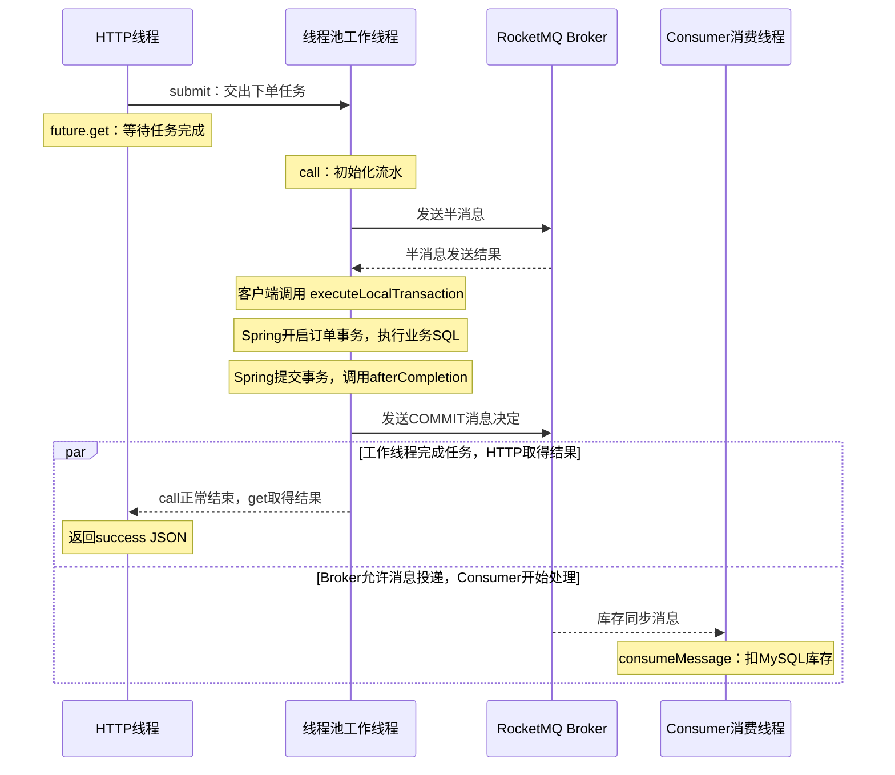

# 秒杀下单执行流程：把线程池、回调、生产和消费讲清楚

> 保存时间：2026-11-20 17:20（Asia/Shanghai）。
>
> 依据：当前工作区源码，以及你本轮提供的下单实验结果。本文没有重新运行实验，也没有修改业务代码。
>
> 讲解范围：`stock-mode=lua`、`mq-async-sync=true`、`queue-discharge=true`、`verify-code=false`。最后单独走一遍仍保留临时 `BusinessException` 的失败实验。

先抓住这句话：**HTTP 线程把下单任务交给工作线程，然后等它做完；工作线程完成订单数据库事务后，才决定 MQ 消息能不能交给 Consumer；Consumer 在自己的线程里扣数据库库存。**

先看第 1～4 部分，弄清楚谁在执行代码。再看正常下单和你的失败实验。暂时不用记住所有方法名。

## 1. 先认识“谁在干活”

线程可以简单理解成：**程序里负责按顺序执行代码的一条工作路线。** 同一个 Java 进程可以有多条路线同时推进。

在这个项目里，先区分以下角色：

| 角色 | 通俗理解 | 在本项目里做什么 |
| --- | --- | --- |
| 浏览器 | 操作页面的人和页面脚本 | 申请秒杀令牌、发送下单请求、显示结果 |
| HTTP 线程 | 接待这次请求的前台 | 执行 Controller，检查请求，并等待下单任务结果 |
| 线程池工作线程 | 接过任务的工作人员 | 初始化流水、调用 Producer、执行本地订单事务 |
| Producer | 发消息的代码 | 把库存同步消息交给 MQ，并告诉 MQ 应该提交还是回滚消息 |
| Broker | 存放和投递消息的中转站 | 保存半消息，收到提交决定后允许投递给 Consumer |
| Consumer 消费线程 | 接收库存同步任务的工作人员 | 执行 `consumeMessage()`，扣 MySQL 库存 |
| MQ 回查处理线程 | 回头核对结果的工作人员 | 在 Broker 发起回查时，执行 `checkLocalTransaction()` |

**Producer、Consumer 是角色名称，本身不等于“一条线程”。**

当前项目里，`MqProducer` 和 `MqConsumer` 都是同一个 Java 应用里的对象；Broker 是另外运行的 RocketMQ 服务。正常下单时，Producer 的本地事务回调由当前工作线程执行，Consumer 则使用消费线程处理消息。

因此，看到 `mqProducer.xxx()`，先把它当成一次普通 Java 方法调用。是否换线程，要继续看内部有没有提交任务、调度回调等动作。

## 2. 为什么源码从上到下写，实际却不能从上到下读

先用三种写法区分。

### 2.1 普通调用：现在就做，做完再往下走

```java
String stockLogId = itemService.initStockLog(itemId, amount);
boolean result = mqProducer.transactionAsyncReduceStock(...);
```

这一段在当前工作线程里是顺序执行的：

```text
先进入 initStockLog()
等它返回 stockLogId
再进入 transactionAsyncReduceStock()
等它返回 boolean
再执行后面的代码
```

调用 Service 对象、Producer 对象，都不会仅仅因为换了对象，就自动换一条线程。

### 2.2 定义任务：先写清楚工作内容，交出去以后才有人执行

```java
Callable<Object> task = new Callable<Object>() {
    @Override
    public Object call() throws Exception {
        // 这里写的是任务内容
        return null;
    }
};
```

执行 `new Callable<>()` 时，只是创建了一个任务对象。**此时还没有执行 `call()` 里面的下单代码。**

可以理解成：先写好一张工作单，上面写着“收到后按这些步骤处理”。写好工作单，和真正处理工作，是两件事。

后面执行：

```java
Future<Object> future = executorService.submit(task);
```

才把这张工作单交给线程池。线程池安排工作线程执行 `task.call()`；忙不过来时任务可能先排队。

### 2.3 注册回调：先交代“到某个时机，请执行这段代码”

“回调”就是：**你把一段处理逻辑交给框架或客户端库，约定它在合适的时候调用。**

项目中有这样的代码：

```java
TransactionSynchronizationManager.registerSynchronization(
    new TransactionSynchronizationAdapter() {
        @Override
        public void afterCompletion(int status) {
            // 数据库事务结束后，框架才会执行这里
        }
    }
);

// 注册完成后，当前线程继续走到这里
OrderModel orderModel = new OrderModel();
```

正确的阅读顺序是：

```text
现在：登记一段“事务结束后要做的事”
    ↓
现在：继续创建订单、执行后面的业务代码
    ↓
稍后：事务真正提交或回滚
    ↓
框架调用刚才登记的 afterCompletion()
```

不要在读到 `afterCompletion()` 的方法定义时，就以为库存已经回补了。方法体只是写在这里，执行时机由框架控制。

**回调也不代表一定换线程。** 例如这条正常下单路径中的 `executeLocalTransaction()` 和 `afterCompletion()`，就在当前工作线程的调用过程中执行。

## 3. 线程池这几个方法，到底各干什么

入口代码见 [OrderController.java](../../src/main/java/com/imooc/miaoshaproject/controller/OrderController.java)，查找 `executorService.submit`。

下面是保留执行关系的简化写法，省略了部分参数和异常分支，不能直接替换源码：

```java
// HTTP 线程执行这一行：把任务交给线程池
Future<Object> future = executorService.submit(new Callable<Object>() {
    @Override
    public Object call() throws Exception {
        // 线程池工作线程执行这里
        String stockLogId = itemService.initStockLog(itemId, amount);

        boolean success = mqProducer.transactionAsyncReduceStock(...);
        if (!success) {
            throw new BusinessException(...);
        }

        return null;
    }
});

// HTTP 线程执行这一行：等任务结束
future.get();

// 只有上面正常返回，HTTP 线程才会走到这里
return CommonReturnType.create(null);
```

| 代码 | 谁执行 | 实际含义 |
| --- | --- | --- |
| `new Callable<>()` | HTTP 线程 | 创建任务对象，写好工作内容 |
| `submit(task)` | HTTP 线程调用 | 提交任务，拿到代表这次任务结果的 `Future` |
| `call()` | 工作线程 | 真正执行任务里的下单逻辑 |
| `future.get()` | HTTP 线程 | 取得结果；任务没完成就等待，已经完成就直接取得结果 |
| `call()` 中的 `return null` | 工作线程 | 告诉线程池“任务正常结束，结果值为 null” |

工作线程可能在线程池接到任务后很快开始执行，甚至早于 `submit()` 向 HTTP 线程返回。两个线程各自推进，所以不能规定它们每一行代码的先后。

`future.get()` 不负责启动任务，也不负责扣库存。任务由线程池执行，它只是让 HTTP 线程等结果。[Java 8 Future 文档](https://docs.oracle.com/javase/8/docs/api/java/util/concurrent/Future.html)

如果任务抛出异常，`future.get()` 会向 HTTP 线程抛出 `ExecutionException`。可以把它理解成：“工作人员没正常完成，这是包着失败原因的结果。”

当前真正使用的线程池配置是 20 个工作线程，等待队列最多放 100 个任务。满载后继续提交会被 `AbortPolicy` 拒绝，Controller 会将拒绝转换为限流错误。

所以，这里能控制同时处理多少任务，但 HTTP 请求仍然在等待。方法名里有 `Async`，也不会改变 `future.get()` 的等待行为。

## 4. 把不同线程放到同一张图里看

这是正常成功路径。图中的方框是执行者，箭头表示调用或交接。



**图中后半段的两个分支没有固定先后。** Consumer 可能在 HTTP 返回前就扣完库存，也可能在返回后才扣完。

确定的约束是：订单事务先完成，Producer 再给出提交消息的决定；Broker 收到并处理提交决定后，消息才能供 Consumer 消费。HTTP 线程只等 `call()` 完成，没有等 Consumer 完成。

## 5. 正常下单：沿着一次任务往里走，再一层层返回

### 5.1 前端先申请令牌，再发送下单请求

源码见 [getitem.html](../../html/getitem.html)，查找 `$("#createorder").on`。

点击下单后，页面先调用 `/order/generatetoken`。它的 `success` 回调里检查业务结果，拿到秒杀令牌后，才调用 `/order/createorder`。

这里的 AJAX `success` 也是回调：浏览器收到对应 HTTP 响应后，执行你写的处理函数。它运行在浏览器里，与 Java 后端的线程池是两回事。

`success` 函数被调用，表示请求层面成功取得了响应；还要检查 JSON 里的 `status`，才能判断业务成功还是失败。

后端申请令牌时检查登录、活动、商品和用户，并减少“大闸名额”；**这一步还没有扣商品库存**。当前页面每次提交的购买数量为 1。

### 5.2 Controller 校验后，把任务交给线程池

`OrderController.createOrder()` 先执行限流，再检查登录、秒杀令牌和售罄标记。

通过后进入 `submit()`。接下来的初始化流水、发送半消息、执行订单事务，都在工作线程的 `call()` 里面继续进行。HTTP 线程在 `future.get()` 等待。

### 5.3 工作线程先保存一条“准备下单”的流水

调用 [ItemServiceImpl.initStockLog()](../../src/main/java/com/imooc/miaoshaproject/service/impl/ItemServiceImpl.java)：

```java
stockLogDO.setStockLogId(UUID.randomUUID().toString().replace("-", ""));
stockLogDO.setStatus(1);
stockLogDOMapper.insertSelective(stockLogDO);
```

`stockLogId` 是这次库存处理的编号，跟订单号是两个不同编号。后续本地订单事务、MQ 消息和事务回查，用它关联同一次处理。

此时 Controller 没有外层数据库事务，`initStockLog()` 自己的 `@Transactional` 会开启并提交一次事务。正常返回后，状态为 1 的流水已经保存在数据库里。

### 5.4 Producer 把半消息交给 Broker

调用 [MqProducer.transactionAsyncReduceStock()](../../src/main/java/com/imooc/miaoshaproject/mq/MqProducer.java)。

Producer 可以理解成“负责发消息的代码”。本次消息大致包含：

```json
{
  "itemId": 6,
  "amount": 1,
  "stockLogId": "本次生成的流水编号"
}
```

消息的意思是：“这次订单成功的话，请扣商品 6 的数据库库存 1 件。”

实际发送使用：

```java
transactionMQProducer.sendMessageInTransaction(message, argsMap);
```

它先发半消息。半消息就是“先收下，暂时不要交给 Consumer，等我告诉你这次订单是否成功”。

**发送半消息不等于 Consumer 已经开始扣库存。**

### 5.5 RocketMQ 客户端现在调用本地事务回调

应用启动时，`MqProducer.init()` 注册了：

```java
transactionMQProducer.setTransactionListener(new TransactionListener() {
    @Override
    public LocalTransactionState executeLocalTransaction(Message msg, Object arg) {
        // 正常下单时，本地订单逻辑从这里进入
    }

    @Override
    public LocalTransactionState checkLocalTransaction(MessageExt msg) {
        // Broker后续发起事务回查时，才从这里进入
    }
});
```

应用启动时，是把这两个处理方法交给客户端，并没有立刻创建订单。

现在，半消息发送成功后，RocketMQ 客户端在 `sendMessageInTransaction()` 的执行过程中，调用第一个方法 `executeLocalTransaction()`。**这次回调就在当前工作线程中执行，外面的发送方法还没有返回。**

依据是项目所用 [RocketMQ 4.3.0 的客户端实现](https://github.com/apache/rocketmq/blob/rocketmq-all-4.3.0/client/src/main/java/org/apache/rocketmq/client/impl/producer/DefaultMQProducerImpl.java#L1010)：发送半消息后调用本地回调，再根据回调结果处理消息。

这两个方法在源码里上下相邻，不代表它们会依次执行。`executeLocalTransaction()` 执行完，不会自动接着调用 `checkLocalTransaction()`。

### 5.6 本地回调进入订单 Service，Spring先开启数据库事务

回调内部调用：

```java
orderService.createOrder(userId, itemId, promoId, amount, stockLogId);
```

这里注入的 `orderService` 外面包着 Spring 的事务代理。可以把代理理解成“负责给数据库操作开账、结账的一层代码”。

调用关系是：

```text
工作线程调用 orderService.createOrder()
    ↓
Spring代理先开启数据库事务
    ↓
进入 OrderServiceImpl.createOrder() 方法体
    ↓
方法体返回或抛异常
    ↓
Spring代理决定数据库提交还是回滚
    ↓
再把返回值或异常交给 Producer 的本地回调
```

源码见 [OrderServiceImpl.java](../../src/main/java/com/imooc/miaoshaproject/service/impl/OrderServiceImpl.java)。

代理这层代码没有直接写在你的 Service 方法体里，所以只按方法体从上往下读，会漏掉“执行方法之前开事务、离开方法时处理事务”这两步。

### 5.7 Service扣Redis、登记回补，再写订单相关SQL

商品、用户、数量和活动通过校验后，执行：

```java
itemService.decreaseStock(itemId, amount);
```

当前走 Lua 分支，在 Redis 中先判断库存够不够，再原子扣减。假设初始为 68，购买 1 件后立即变成 67。

然后执行 `registerSynchronization(...)`，登记 `afterCompletion()`：等这次数据库事务结束，如果结果是回滚，就尝试回补 Redis。

登记完继续执行：

```text
构建订单：用户、商品、数量、活动价格、订单总价
→ generateOrderNo()生成订单号
→ orderDOMapper.insertSelective()写订单
→ itemService.increaseSales()加销量
→ stockLogDOMapper.updateByPrimaryKeySelective()把流水改为2
```

订单号中的序列通过 `FOR UPDATE` 读取并更新，属于当前订单事务。源码里私有方法上的 `REQUIRES_NEW`，在这种同类内部调用下不会另开一个事务。

这里有三件事要分开看：

| 操作 | 什么时候生效 |
| --- | --- |
| Redis库存扣减 | Redis命令执行成功后就已经改变 |
| 订单、销量、流水SQL | 当前数据库事务中已经执行，仍需要最后提交 |
| 登记的回补逻辑 | 等数据库事务结束时，Spring才调用它 |

`decreaseStock()`、`increaseSales()` 虽然也标了 `@Transactional`，但当前默认会加入订单事务，方法返回时不会各自提交一次。MySQL 事务也不会自动撤销 Redis 修改。

### 5.8 正常返回时，Spring提交订单事务，并调用afterCompletion

没有触发临时故障的正常路径会执行：

```java
return orderModel;
```

这个 `return` 先回到 Spring 事务代理。代理完成数据库提交后，触发此前登记的 `afterCompletion(status)`。

**提交和回滚都会调用 `afterCompletion()`。** 当前代码只在下面这个判断成立时加回 Redis 库存：

```java
if (status == TransactionSynchronization.STATUS_ROLLED_BACK) {
    itemService.increaseStock(itemId, amount);
}
```

正常提交时状态为 `STATUS_COMMITTED`，判断不成立，于是回调执行完，没有回补。之后代理把 `orderModel` 交回 Producer 的本地回调。

本条路径中的 `afterCompletion()` 仍由当前工作线程执行。源码里回补失败后的 `Thread.sleep()`，也会让这个工作线程暂时等待，不会自动变成后台定时任务。

### 5.9 Producer告诉Broker提交消息，之后两条路线各自推进

`executeLocalTransaction()` 没有接到业务异常，返回：

```java
return LocalTransactionState.COMMIT_MESSAGE;
```

这里的 `return` 是把决定交回 RocketMQ 客户端。客户端向 Broker 发送消息提交决定。

随后有两条路线：

| 返回请求的路线 | 消费消息的路线 |
| --- | --- |
| 发送方法返回 `TransactionSendResult` | Broker收到并处理COMMIT后，消息可投递 |
| `transactionAsyncReduceStock()`返回 `true` | Consumer消费线程收到消息 |
| `call()`正常返回 `null` | 客户端调用 `consumeMessage()` |
| HTTP线程的`future.get()`正常返回 | Consumer执行数据库库存扣减 |
| Controller返回`success` JSON | Consumer返回消费结果给客户端 |

表格中的每一列内部按顺序推进，两列之间没有“HTTP一定先返回”或“库存一定先扣完”的固定顺序。

**`COMMIT_MESSAGE` 提交的是消息状态；MySQL订单事务此前已经由Spring提交。**

### 5.10 Consumer收到消息后，在消费线程里扣数据库库存

应用启动时，[MqConsumer.init()](../../src/main/java/com/imooc/miaoshaproject/mq/MqConsumer.java) 注册了消息处理方法 `consumeMessage()`，并启动 Consumer。

注册时没有库存消息，就不会因为“代码里定义了方法”而立即扣库存。消息可以消费时，客户端才安排消费线程调用它。

当前处理顺序是：

```text
解析消息里的itemId、amount、stockLogId
→ Redis SETNX设置去重标记
→ 已有标记就跳过；首次处理则设置标记有效期
→ 调用Mapper扣MySQL库存
→ 返回CONSUME_SUCCESS
```

消费就是“收到消息后，按消息要求执行工作”。Producer没有直接调用 `consumeMessage()`；消息经过 Broker 后，由 Consumer 客户端触发这个回调。

SQL见 [ItemStockDOMapper.xml](../../src/main/resources/mapping/ItemStockDOMapper.xml)：

```sql
UPDATE item_stock
SET stock = stock - #{amount}
WHERE item_id = #{itemId}
  AND stock >= #{amount};
```

正常第一次消费、库存也充足时，MySQL库存从68减为67。

`CONSUME_SUCCESS` 是交给 RocketMQ 客户端的“本次消费处理成功”结果，不是交给浏览器的下单响应。当前去重标记和数据库扣减没有放在同一个事务里，SQL更新0行也没有检查；所以这里讲的是正常执行关系，不能据此认定所有故障都处理正确。

## 6. checkLocalTransaction回查：它不属于每单必走的一步

Broker可能没有拿到最终消息决定，例如应用在本地处理期间退出，或提交决定没有送达。到需要核查时，Broker会向Producer发起事务回查。

客户端收到回查请求后，通过独立的回查处理线程调用：

```java
checkLocalTransaction(MessageExt msg)
```

当前实现拿消息里的 `stockLogId` 查数据库：

| 当前流水状态 | 回查返回值 | 通俗含义 |
| --- | --- | --- |
| 查不到流水 | `UNKNOW` | 暂时无法确认 |
| `1` | `UNKNOW` | 还不能认定已完成 |
| `2` | `COMMIT_MESSAGE` | 按当前流水判断，允许消息投递 |
| `3` | `ROLLBACK_MESSAGE` | 按当前流水判断，回滚消息 |

它只查询和判断，不会重新执行 `createOrder()`。

它可能在原任务仍在处理时发生，也可能在后续发生；不需要等 HTTP 返回才有资格回查。遇到 `UNKNOW`，Broker会按自身策略继续处理或再次回查，不能把它等同于“确定失败”。

回查依据本身也可能不准确：你的实验就证明，状态3与“订单已提交”可以同时存在。不能仅靠流水上的状态名推断数据库做过什么。

## 7. 用你的实验，逐步看清“失败了为什么还留下订单”

你提供的实验数据：

| 数据 | 下单前 | 下单后 |
| --- | --- | --- |
| MySQL库存 | 68 | 68 |
| 销量 | 144 | 145 |
| 活动1、商品6订单数 | 5 | 6 |
| Redis库存 | 68 | 67 |
| 本次流水 | 尚未创建 | 状态3 |

本次订单号：`2026112000004900`。本次流水号：`227767ff1f434d549db826b6c79f3b75`。

前面的收请求、线程池提交、创建状态1流水、发半消息、进入订单事务，都与正常路径一致。变化发生在写入订单、销量和状态2之后：

```java
if (itemId == 6 && amount == 1) {
    throw new BusinessException(EmBusinessError.UNKNOWN_ERROR);
}
```

### 7.1 异常先交给Spring代理，Producer此时还没接到它

Service方法体抛出异常后，调用关系是：

```text
Service方法体抛出BusinessException
    ↓
Spring事务代理先接到异常，判断是否回滚
    ↓
数据库事务结束，并触发afterCompletion
    ↓
再向外抛异常
    ↓
Producer的catch接到异常
```

当前 `BusinessException` 继承 `Exception`，而订单方法只写了默认的 `@Transactional`。这个受检异常没有命中默认回滚规则，因此Spring提交了订单事务。[Spring 5.0.9默认回滚规则](https://docs.spring.io/spring-framework/docs/5.0.9.RELEASE/spring-framework-reference/data-access.html#transaction-declarative-rolling-back)

也就是说，虽然业务代码抛异常，数据库仍然提交了：订单、销量、状态2的流水。

### 7.2 afterCompletion被调用了，但是没有执行回补

数据库提交完成后，Spring调用 `afterCompletion(STATUS_COMMITTED)`。

判断过程是：

```text
这次数据库事务已经提交
→ status不是STATUS_ROLLED_BACK
→ 不进入increaseStock()
→ Redis库存继续保持67
```

所以，准确的说法是：**回调执行了，回调里的“回滚才补库存”分支没有执行。**

这里的 `status` 是Spring传入的数据库事务完成状态，和表字段 `stock_log.status` 是两套值。把流水改成3，不会让这个回调重新触发。

### 7.3 Producer随后接到异常，再把流水从2改成3

现在才进入 `MqProducer.executeLocalTransaction()` 里的：

```java
catch (BusinessException e) {
    StockLogDO stockLogDO = stockLogDOMapper.selectByPrimaryKey(stockLogId);
    stockLogDO.setStatus(3);
    stockLogDOMapper.updateByPrimaryKeySelective(stockLogDO);
    return LocalTransactionState.ROLLBACK_MESSAGE;
}
```

订单事务已经结束，这次修改流水是后续独立写入。于是出现：

```text
订单和销量已经提交
流水随后又从2被改成3
```

这解释了为什么你同时查到了订单和“失败流水”。`setStatus(3)` 只是在改一列数据，不是执行数据库事务回滚。

### 7.4 MQ回滚半消息，Consumer没有本次库存任务可做

Producer返回 `ROLLBACK_MESSAGE` 后，客户端通知 Broker回滚这条半消息。它不会供Consumer消费。

因此本次没有进入 `consumeMessage()` 扣MySQL库存的路径，数据库库存还是68。

**MQ消息回滚只决定这条消息是否投递，不会撤销已经提交的MySQL订单。**

### 7.5 工作线程把失败交给HTTP线程，页面显示下单失败

完整的返回关系是：

```text
executeLocalTransaction()返回ROLLBACK_MESSAGE
→ RocketMQ客户端把这个结果带回发送方法
→ transactionAsyncReduceStock()看到回滚结果，返回false
→ call()看到false，抛出新的BusinessException
→ HTTP线程的future.get()抛出ExecutionException
→ Controller捕获后，抛出BusinessException
→ GlobalExceptionHandler返回status=fail的JSON
→ 浏览器收到响应，显示下单失败
```

统一异常响应见 [GlobalExceptionHandler.java](../../src/main/java/com/imooc/miaoshaproject/controller/GlobalExceptionHandler.java)。

外层“又抛一次异常”时，订单事务早已完成。这个Controller上的异常不会倒回去，把之前提交的订单重新撤销。

本次数据变化可以按责任对应起来：

| 最终现象 | 对应哪段代码 |
| --- | --- |
| Redis：68→67 | Service调用Lua扣库存，事务提交后未执行回补分支 |
| 新增订单，销量144→145 | Spring面对本次受检业务异常，仍提交订单事务 |
| 流水最后为3 | Producer的catch在订单事务结束后改写流水 |
| MySQL库存仍是68 | 半消息被回滚，Consumer没有执行本次库存同步 |
| 页面显示失败 | 工作任务返回失败，最终转换成fail JSON |

## 8. 各种回调放在一起对照

| 方法 | 什么时候把它交出去 | 谁在什么时机调用 | 本项目中通常在哪执行 |
| --- | --- | --- | --- |
| AJAX的`success` | 浏览器发请求时提供处理函数 | 浏览器收到对应响应后 | 浏览器里 |
| `Callable.call()` | Controller调用`submit()`提交任务 | 线程池安排任务执行时 | 线程池工作线程 |
| `executeLocalTransaction()` | 启动时注册事务监听器 | 客户端发半消息成功后的发送流程中 | 当前下单工作线程 |
| `afterCompletion()` | 下单事务中登记同步回调 | Spring完成数据库提交或回滚时 | 本条路径中的当前工作线程 |
| `consumeMessage()` | 启动时注册消费监听器 | 消息可消费，客户端安排处理时 | Consumer消费线程 |
| `checkLocalTransaction()` | 启动时注册事务监听器 | Broker发起回查，客户端处理时 | MQ回查处理线程 |

源码里还有整段被注释的 `afterCommit()` 代码。它目前没有注册，也不会执行。不要把它算成当前链路中又发一次库存消息。

读到一个回调时，依次确认这三件事就够了：

1. **在哪里登记？** 找 `submit`、`setTransactionListener`、`registerSynchronization` 或 `registerMessageListener`。
2. **等什么事情才执行？** 任务被调度、半消息发成功、事务结束、消息到达，还是Broker回查。
3. **谁来执行？** 当前线程继续执行，还是另一个工作线程执行。

## 9. 对照源码时，按这个顺序看

| 顺序 | 文件与搜索词 | 本次只关注什么 |
| --- | --- | --- |
| 1 | [getitem.html](../../html/getitem.html)：`createorder` | 点击后先申请令牌，再发送下单请求；响应回调怎样显示结果 |
| 2 | [OrderController.java](../../src/main/java/com/imooc/miaoshaproject/controller/OrderController.java)：`submit`、`future.get` | HTTP线程和工作线程在哪里分开、在哪里等结果 |
| 3 | [ItemServiceImpl.java](../../src/main/java/com/imooc/miaoshaproject/service/impl/ItemServiceImpl.java)：`initStockLog` | 状态1的流水什么时候保存 |
| 4 | [MqProducer.java](../../src/main/java/com/imooc/miaoshaproject/mq/MqProducer.java)：`sendMessageInTransaction`、`executeLocalTransaction` | 发半消息后怎样绕回本地订单方法，结果又返回给谁 |
| 5 | [OrderServiceImpl.java](../../src/main/java/com/imooc/miaoshaproject/service/impl/OrderServiceImpl.java)：`createOrder`、`registerSynchronization` | Redis预扣、数据库写入、回补回调的登记与触发 |
| 6 | [MqConsumer.java](../../src/main/java/com/imooc/miaoshaproject/mq/MqConsumer.java)：`consumeMessage` | 独立消费线程在哪里真正扣MySQL库存 |
| 7 | [MqProducer.java](../../src/main/java/com/imooc/miaoshaproject/mq/MqProducer.java)：`checkLocalTransaction` | 后续回查怎样根据流水作决定 |

本次只创建说明文档并登记文档入口，没有修改或测试业务逻辑。当前源码仍保留临时故障注入，商品6购买1件会继续触发失败；删除注入代码并重启，也不会自动撤销实验已产生的不一致数据。
